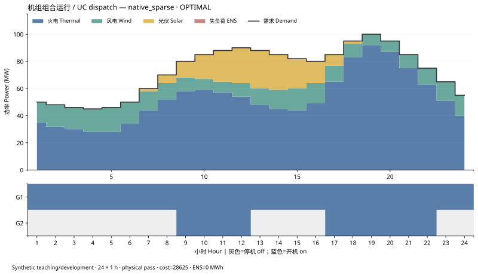

# ZYO：自主 LP/MILP 研究求解器

当前公开源码为 **0.3.7 研究开发候选版**。ZYO 提供 Python 线性建模接口、三个自主求解路径和可复核的教学算例。源码可本地安装、运行和研究；它尚不是成熟的工业通用求解器。作者为 Ziyuan Li，开发过程使用了 ChatGPT 6 辅助。

[安装与入门](docs/quickstart_zh.md) · [能力与限制](docs/limitations.md) · [数学与数值边界](docs/native_simplex.md) · [版本记录](CHANGELOG.md) · [参与开发](CONTRIBUTING.md)

## 先看实际能力

| 路径 | 已实现的计算 | 当前边界 |
| --- | --- | --- |
| `native` | 自编密集两阶段单纯形与基本分支定界 | 密集表规模受保护；适合小型 LP/MILP 教学与回归 |
| `native_sparse` | 自编稀疏原始—对偶内点法、有限盒处理与基本分支定界 | 非有限域需人工盒阶梯和原域回查；困难整数搜索仍未充分验证 |
| `native_simplex` | 自编有界变量稀疏修正单纯形与原模型 KKT 检查 | LP 专用；小基后验认证仅覆盖限定规模，大型退化题仍可能数值未决 |

自主路径使用 NumPy、SciPy 稀疏矩阵与 SuperLU 等基础数值组件，**不调用外部优化器，也不静默回退**。HiGHS、Gurobi、COPT 适配器只用于显式隔离比较。结果中的可行解、下界和 Gap 要与真实停止状态一起阅读；达到时间或节点限制不等于证明最优。

0.3.7 的重点是原存储 binary64 模型的逐项证书复核：先对乘积精确累加，再核行、界、对偶符号、简约成本和原始—对偶差。手算四行 LP 可经独立证书后验认证，同时保留底层 `NUMERICAL_ERROR` 原因。自编 24 小时紧备用机组组合算例由 `native_sparse` 求得目标 `39856.801000227846`、ENS 为 0，并通过原模型与物理检查；三轮逐小时前缀各有 23/24 个获接受最优，2 小时数值反例保留。相同候选源码在四个 Netlib 开发题各三次的更严格原模型证书复核中为 **0/12 通过**。这些结果分别说明小题成功与大题边界，不能合并成一般求解率。[算例公式与结果](docs/synthetic_uc_examples.md) · [0.3.7 图件及证据](docs/releases/0.3.7.md)。

## 安装与第一个模型

已直接验证的环境为 64 位 Windows、Python 3.10.19。其他平台需要自行运行测试；本仓库当前是 GitHub 源码发布，未发布到 PyPI。

```powershell
git clone https://github.com/Entropyneverfade/ZYO.git
cd ZYO
python -m venv .venv
.\.venv\Scripts\python.exe -m pip install -e ".[native-sparse,storage]"
.\.venv\Scripts\python.exe -X utf8 -m unittest discover -s tests -v
```

Linux/macOS 将解释器路径改为 `.venv/bin/python`。仅用密集内核可以安装 `-e .`；仅用稀疏 LP 可安装 `-e ".[native-sparse]"`。完整公开测试会重绘图，因此上方安装同时包含 `storage` 绘图依赖。初次安装依赖需要网络，安装完成后本地求解不需要联网。

```python
import zyo as zo

m = zo.Model("first_model")
x = m.add_var("x", lb=0, ub=10)
y = m.add_var("y", vtype="B")
m.add_constr(x + 2*y >= 4, name="demand")
m.minimize(3*x + 2*y)

r = m.solve("native")
print(r.status, r.objective, r.best_bound, r.mip_gap)
if r.has_solution:
    print(r.values)
```

该模型可手算出 `x=2`、`y=1`、目标 8。使用 ZYO 时请同时检查状态、候选解、界、Gap 和原始约束残差。[更多安装与建模说明](docs/quickstart_zh.md)。

## 算例、图件与集成

- [0.3.7 数值反例和独立证书](docs/releases/0.3.7.md)：逐图附源数据、重绘脚本、后端与 QA；图为解析反例，不是性能排名。
- [0.3.6 稀疏输入](docs/releases/0.3.6.md)：1420 阶对角 LP 的矩阵缓冲区字节比及独立 KKT；字节比不是求解加速比。
- [0.3.3 年度逐时算例](docs/releases/0.3.3.md)：8760 次独立 DC/PWL 调度，报告展示第一周逐时图与月度电量图，全年核验依据原逐时记录；不代表全年机组组合或概率充裕度。
- [24 小时机组组合实测](docs/uc_results.md)：自主路径与外部优化器分进程比较，图和状态对应同一输入。
- [GRIDMIND 调用契约](docs/solver_contract.md)：冻结年度状态路径小算例可选用 ZYO，并保留请求和实际后端、模型指纹、状态、目标、界与 Gap。当前 GRIDMIND 的 Gurobi 主流程仍保留；状态路径一致不等于逐时物理模拟或充裕度闭环已验证。



图中为合成教学算例，展示已记录的出力、负荷与机组状态；完整输入、单位和验收口径见[实测页](docs/uc_results.md)。

## 许可与范围

自 0.3.4 起，受限新增内容采用[ZYO 非商业测试许可 1.0.0](LICENSE)，按账号和用途申请，默认测试期 90 日。历史 MIT 代码和第三方材料保留各自权利，具体边界以[范围清单](LICENSE-SCOPE.json)、[历史 MIT 文本](LICENSES/MIT-legacy.txt)及[第三方声明](THIRD_PARTY.md)为准。申请只需概括用途，不索取实名、联系方式或单位；公开 Issue 会显示账号及提交内容，请勿写入隐私。[申请说明](docs/licensing-and-access.md) · [申请入口](https://github.com/Entropyneverfade/ZYO/issues/new?template=zyo-test.yml)。商用、生产、再分发和服务须另获许可；本地 `import zyo` 不需要远程 API 密钥。
