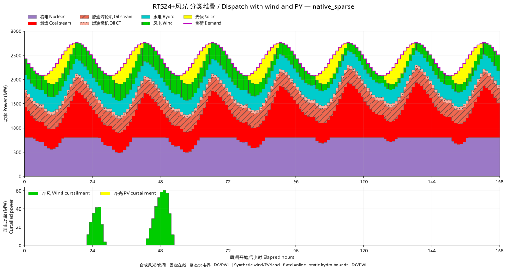
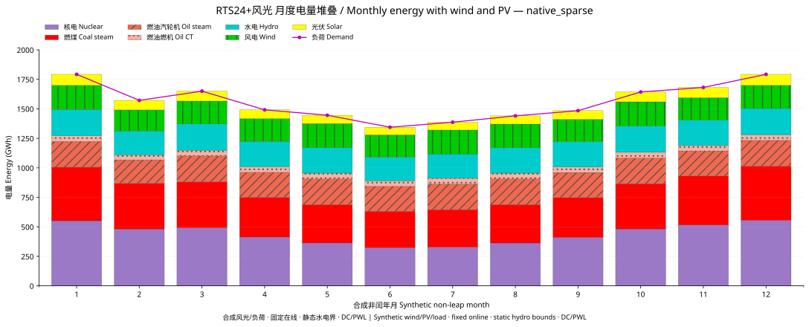
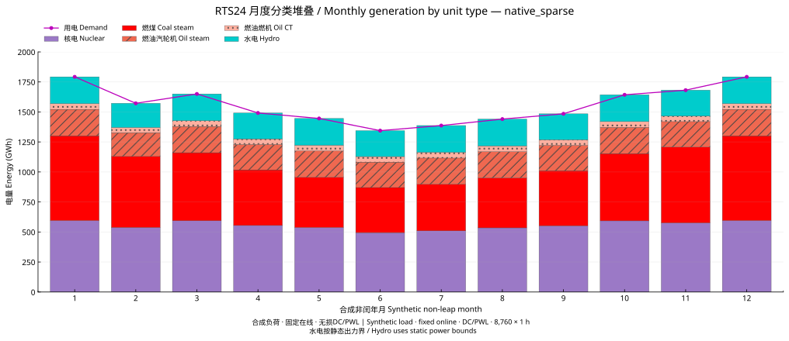
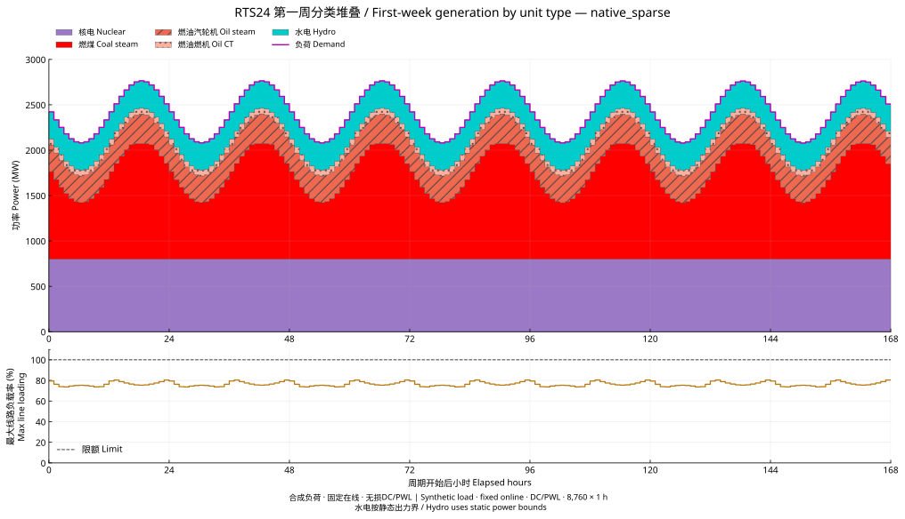

# 0.3.3 更新小结与图集

原计算：2026-09-08；公开图文修订：2026-10-15。结果数值和原始计算身份不变。

## 本版解决的问题

本版把“ZYO能否自主完成带网络约束的全年逐时经济调度”落实为两个可复查的计算：原RTS24网络基准，以及同一系统增加风电、光伏后的运行场景。两组各8760小时均通过原生求解和原始物理检查。含风光场景供给了年用电量的17.57%，按同一成本口径计算的运行成本下降8.07%。这些数值描述的是下文固定容量、固定在线、合成时序的DC/PWL调度模型。

算例沿着“小型机组组合验证→RTS24网络逐时调度→全年基准→增加新能源”的开发顺序形成。本版先用公开静态网络固定输入基线，再通过合成负荷扩大时序覆盖；随后保持网络、常规机组、负荷和成本口径一致，仅增加两个风光接入点，观察电源替代、弃电和网络约束下的调度结果。原场景按机型重绘属于原解的分类展示；风光场景则实际新增变量和可用出力约束，并重新自主求解。

## 完成内容

- 增加LP局部CSC结构复用、失效检查和独立存储；20题120次同核消融的7项数值输出一致。结构重建17,394→1,965次，逐题中位调用时间之和9.527917→9.241643秒（减少3.00%）。[方法与逐题耗时](../sparse_reuse.md)。
- 完成RTS24合成8760小时逐时自主DC/PWL调度；重新从原输入与完整解复算8760小时功率平衡、线路方程、出力界及成本，保留第一周逐时图、月度分类图和[月度数据](../figures/0.3.3/monthly.csv)。
- 加入缺失/损坏实验记录、输入/协议身份和图形聚合的独立检查，落实文献优先诊断与版本图集归档。

## 输入如何形成

电网来自固定版本MATPOWER8.1 RTS24文件，发电类型由原RTS表补充。负荷和风光曲线用明确公式生成，使用确定性小时索引；本场景的发电装机为给定参数，优化选择每小时的出力。下面两列是两个独立场景，不是同一结果的两种配色。

| 输入 | 原 RTS24 基准 | 含风光场景 |
|---|---|---|
| 网络 | 24 节点、38 支路，100 MVA 基准，13 号参考节点 | 与基准相同 |
| 原机组 | 32 台有功发电机组，1 台同步调相机 | 完整保留 |
| 原机组类型与装机 | 核电 800、煤电 1274、燃油汽轮机 951、燃油燃机 80、水电 300 MW | 与基准相同 |
| 新能源装机 | 风、光均为 0 MW | 3 号节点风电 600 MW；10 号节点光伏 400 MW |
| 时间与需求 | 合成非闰年，8760 个 1 小时时段；年用电 18,724.5 GWh | 完整复用同一负荷倍率 |
| 成本 | 源算例发电成本，凸分段线性近似，单位为算例成本单位 | 原成本保留；风、光边际成本为 0 |
| 运行方式 | 固定在线、静态出力界、严格节点供电、无损直流潮流 | 同上；风、光实发可低于可用量 |

以 $h=0,\ldots,8759$ 、 $k=h\bmod24$ 、 $d=\lfloor h/24\rfloor$ 定义小时、日内小时和日索引。各节点原负荷 $d_i^0$ 乘同一倍率 $\lambda_h$ ；风电可用率为 $\phi_{W,h}$ ，光伏可用率为 $\phi_{S,h}$ ：

$$
\lambda_h=0.75+0.12\cos\frac{2\pi(k-18)}{24}
+0.10\cos\frac{2\pi h}{8760},\qquad
\phi_{W,h}=0.45+0.20\sin\frac{2\pi h}{168}+0.10\cos\frac{2\pi k}{24},
$$

$$
\phi_{S,h}=\begin{cases}
\sin\!\left(\frac{\pi(k-6)}{12}\right)
\left(0.85+0.15\cos\frac{2\pi d}{365}\right),&6<k<18,\\
0,&\text{其余小时}.
\end{cases}
$$

这套公式用于生成可重复的开发输入；研究中替换真实曲线时，需同步提供时间戳、时区、缺测处理、装机与可用率口径。源码对应 `synthetic_load_factors`、`availability` 和 `examples/rts24_renewables.json`；当前profile标识为 `synthetic-hourly-v1`。

## 系统结构与实际优化模型

本版原场景与含风光场景使用同一网络及常规机组。以[MATPOWER 8.1 固定版本算例文件](https://github.com/MATPOWER/matpower/blob/8.1/data/case24_ieee_rts.m)为来源，核对得到 24 个节点、38 条支路，其中 4 对为平行回路，13 号节点为参考节点。含风光场景另在 3 号节点叠加 600 MW 风电、10 号节点叠加 400 MW 光伏；两项装机均为合成开发设置。支路连接按源文件端点核对，不用示意图中的线条交叉推断电气连接。

完整拓扑示意与衍生数据先保存在内部审计材料中；公开报告只给出来源链接及已核对的汇总事实。原年度输入、逐时解和性能数值保持原身份。

### 目标函数与成本线性化

每小时 $t=0,\ldots,8759$ 求解固定在线机组的DC调度LP。 $p_{g,t}$ 为出力MW， $z_{g,t}$ 为每小时成本辅助变量， $\Delta t=1$ 小时；全年成本按各小时累加。实际实现逐小时最小化 $\sum_g z_{g,t}$ ，与下式独立时段模型等价：

$$
\min\ \sum_{t=0}^{8759}\Delta t\sum_{g\in\mathcal G}z_{g,t}.
$$

源成本 $q_g(p)=a_gp^2+b_gp+c_g$ 在出力区间上用凸弦线近似。 $a_g>0$ 时等分8段；线性成本用1段；固定出力直接固定成本。区间端点 $P_{g,k}$ 、 $P_{g,k+1}$ 对应：

$$
z_{g,t}\ge
[a_g(P_{g,k}+P_{g,k+1})+b_g]p_{g,t}
+c_g-a_gP_{g,k}P_{g,k+1},\quad \forall k,
$$

$$
q_g(P_g^{\min})\le z_{g,t}\le q_g(P_g^{\max}),\qquad
0\le\widehat q_g(p)-q_g(p)\le \frac{a_g(\delta P_g)^2}{4}.
$$

这里 $\delta P_g=(P_g^{\max}-P_g^{\min})/n_g$ ， $n_g$ 是上述分段数。成本系数在本输入范围非负，出力也非负，故上述成本界有效。误差界是同一出力点的弦线近似误差；年度界可按小时/机组累加，成本与近似误差独立复算。实际求解对象为此PWL线性模型。成本沿用源算例单位，图文统一注明“算例成本单位”。

### 出力、网络与供电约束

机组静态出力界；新增风/光 $r\in\{W,S\}$ 的时变可用率 $\phi_{r,t}$ 与装机 $K_r$ 决定上界，零边际成本。弃电 $c_{r,t}$ 是求解后由可用量减实发计算的量：

$$
P_g^{\min}\le p_{g,t}\le P_g^{\max},\qquad
0\le p_{r,t}\le K_r\phi_{r,t},\qquad
c_{r,t}=K_r\phi_{r,t}-p_{r,t}.
$$

节点集合 $\mathcal B$ ，支路 $\ell=(i,j)$ 按数据行方向定义正向。所有机组（含新增风光）完整计入所属节点供给，负荷 $d_{i,t}=\lambda_t d_i^0$ ，严格供电采用等式：

$$
\sum_{g\in\mathcal G_i}p_{g,t}
-\sum_{\ell\in\delta^+(i)}f_{\ell,t}
+\sum_{\ell\in\delta^-(i)}f_{\ell,t}=d_{i,t},\quad \forall i,t.
$$

DC潮流使用 $S_{\mathrm{base}}=100$ MVA、标幺电抗 $x_\ell>0$ 、变比 $\tau_\ell>0$ （原值0转为1）、弧度相移 $\psi_\ell$ ，角度 $\theta$ 用弧度； $F_\ell$ 采用算例 rateA 并在DC模型中作为MW限额：

$$
f_{\ell,t}=\frac{S_{\mathrm{base}}}{x_\ell\tau_\ell}
(\theta_{i,t}-\theta_{j,t}-\psi_\ell),\qquad
-F_\ell\le f_{\ell,t}\le F_\ell,\qquad \theta_{13,t}=0.
$$

稀疏模型需要的有限角界由上述支路限额推导。任意参考节点到节点 $i$ 的路径都给出界，取非负边权最短路径的最紧此类界 $B_i$ ：

$$
|\theta_{i,t}|\le B_i,\qquad
B_i=\min_{\pi:13\leadsto i}
\sum_{\ell\in\pi}\left(|\psi_\ell|+\frac{F_\ell x_\ell\tau_\ell}{S_{\mathrm{base}}}\right).
$$

本版模型采用固定在线、逐时独立、静态水电出力界和零有功网损；模型边界与拓扑图配套阅读。公式核对入口为本地维护源码 tools/rts24_pilot.py 的 build_snapshot/check_snapshot 与 tools/rts24_renewables.py 的 renewable_case/check_renewables；图和公式均来自同一数学对象。

## 实际计算与输出验收

计算按24小时、168小时、8760小时递增。年度风光任务首先重新核对168小时先导的输入、代码身份和原始解，然后逐小时建立上述LP，显式调用 `ZYO native_sparse 0.3.3`。各小时独立求解，原生路径启用外部优化模块导入禁令；完整日志中的回退标志与实际引擎随每份结果保存。线性代数使用基础数值库，自编优化内核执行搜索与最优性检查。

原场景每小时128变量、248约束、595非零元；含风光场景132变量，夜间249约束/598非零元，光伏可用时250约束/599非零元，整数变量均为0。昼夜行数差异来自零可用光伏的成本直接固定。年度计算是8760个上述小LP的连续执行与汇总，输出规模和单次LP规模分别记录。

验收同时使用求解状态、原模型候选检查、目标重算和原始网络检查：节点平衡、线路方程、出力/线路界与参考角在记录的 $10^{-7}$ 容差下通过；最优目标与下界满足 $0\le J-L\le10^{-7}\max(1,|J|)$ ；报告目标与原输出重算值差在 $10^{-6}+10^{-7}\max(1,|J|)$ 内。还按原成本函数检查PWL误差界。ENS=0对应这条给定曲线在严格供电模型中的逐时供需平衡，使用确定性指标名称。

| 输出 | 含义与用途 |
|---|---|
| `input.json`、`first-model.json` | 保存网络、场景、倍率、来源哈希及首小时数学模型，用于核对计算对象。 |
| `hour-0000.json` 至 `hour-8759.json` | 保存机组出力、节点角、支路潮流、成本辅助量、状态、下界、耗时及残差，用于逐小时复算。 |
| `hourly.csv`、月度 CSV | 保存逐时物理量与分类电量；MW 乘 1 小时得到 MWh，月度再除 1000 得到 GWh。 |
| `summary.json`、监督日志 | 汇总通过小时数、成本、缺电量、风光可用量、实发、弃电、耗时与资源，并区分循环和整个进程的计时。 |
| 第一周图、月度图及全年数据 | 分别查看逐时调节、月度电量构成和全年核验结果，均绑定同场景原始输出。 |

## 主展示：含新能源场景

本节两张主图来自风电 600 MW、光伏 400 MW 的独立年度计算；后面的基准场景风、光容量均为 0。两组各用自己的原始解，出力和成本不跨场景混用。

在节点3增加600 MW风电、节点10增加400 MW光伏，容量与时序均为合成开发设置。原网络、原机组及负荷曲线保持；新能源零边际成本、实发上界等于容量乘可用率，允许弃风弃光，严格供电。[线性可用率界参考](https://docs.pypsa.org/v1.0.2/user-guide/optimization/dispatch-limits/)。

先通过24/168小时，再完成8760/8760逐时原生OPTIMAL及原始模型/物理检查。年度循环183.014秒，含出图的监督进程185.545秒、峰值RSS262.69 MiB；ENS0，PWL成本374,263,033.086937（算例成本单位）。最大节点平衡残差6.073e−8 MW、线路方程残差9.514e−8 MW。

| 电量（MWh） | 风电 | 光伏 |
|---|---:|---:|
| 可用 | 2,366,361.006230 | 942,633.085389 |
| 实发 | 2,346,989.380952 | 942,633.065280 |
| 弃电 | 19,371.625278 | 0.020109 |

第一周图保留168小时阶梯。绿色为风电实发、黄色为光伏实发，其余五层为常规机组类型；层厚表示该类当小时出力，合计与负荷线核对。下图单独画弃风弃光，便于把“可用电量”与“进入供需平衡的实发”区分开，并选取需要深入检查的时段。

月度图按每月实际小时数积分，各颜色柱段为发电量GWh。它回答“这一月的需求由哪些电源满足”，适合与月度CSV核对发电占比。月间电量差同时受到天数、负荷和可用率影响；比较利用水平时需要按容量与小时数归一化。全年8760小时的最优状态与残差仍依据原小时记录核验，月度图不用于推断逐时峰值或拥塞。

[含风光月度分类数据](../figures/0.3.3/monthly_renewables.csv)。上述图采用固定在线、静态水电出力界和直流潮流与分段线性成本模型；出力调节不包含新增启停决策。

## 原RTS24场景指标

| 指标 | 实测值 |
|---|---:|
| 实际引擎与版本 | ZYO native_sparse 0.3.3 |
| 接受最优的小时 | 8760 / 8760 |
| 每小时变量、约束、非零元、整数变量 | 128 / 248 / 595 / 0 |
| 调度循环 | 171.939 s |
| 监督进程总时间 | 172.858 s |
| 进程峰值 RSS | 69.68 MiB |
| 年用电量 | 18,724.5 GWh |
| 年分段线性成本 | 407,128,450.150720 算例成本单位 |
| 缺电量 | 0 MWh |
| 最大节点平衡残差 | 5.438e−8 MW |
| 最大线路方程残差 | 9.487e−8 MW |
| 最高线路负载率 | 80.7664% |

**模型与来源。** [MATPOWER8.1 case24_ieee_rts.m](https://github.com/MATPOWER/matpower/blob/8.1/data/case24_ieee_rts.m)：24节点、33条机组记录（含1条同步调相机）、38条线路。各小时固定在线、无损DC、8段凸弦线成本近似，线性可行性容差1e−7。合成非闰年负荷倍率为 `0.75 + 0.12*cos(2*pi*((h%24)-18)/24) + 0.1*cos(2*pi*h/8760)`，`h=0,...,8759`。各小时是独立调度；本页图展示这一明确模型。

来源文件 SHA-256： `a383a9001fd03ab54b2bc590364a71119fd07e82ab814adfd824ce08f9eb26ce`。

## 按机组类型的算例堆叠图

两张保留的图均采用分类堆叠。机型来源为[华盛顿大学RTS原始数据档案](https://labs.ece.uw.edu/pstca/rts/pg_tcarts.htm)，逐行读取MATPOWER机组的U12/U20等单位代码，并与RTS1979类型、RTS1996表9的热机/燃料类型核对：核电2台、水电6台、燃煤汽轮机9台、燃油汽轮机11台、燃油燃机4台。另1台同步调相机P=0，单独记录。

水电沿用青色，火电采用红色系和分型纹理，核电新增紫色，负荷用紫红线；无风光数据的本算例按实际类型出图。单位类型的补充仅用于原解分类，逐小时总功率、成本和线路结果保持原值。水电在本次静态模型中采用出力上下界；水量、库容和跨时段调节属于独立模型里程碑。

[分类月度数据](../figures/0.3.3/monthly_types.csv)。第一周保留逐小时阶梯；五类相加逐时核对总发电量，月度按原8760小时积分。

## 原RTS24对照：风光容量为0

以下两图展示基准场景的五类机组出力；该场景没有新增风光。全年逐时线路负载率、平衡与成本仍按原小时解验算，概览改用月度电量，避免在一张图中压缩8760个时段。

### 月度电量

逐小时MW乘1小时后累加为MWh，再除1000得到GWh；月份按非闰年实际天数划分。

### 第一周逐时运行

预先选择第一完整周；核电紫、煤红、燃油汽轮机珊瑚红斜纹、燃油燃机浅红点纹、水电青，品红线为负荷。每一小时分类合计等于原机组总出力。

## 结果的指导意义与扩展顺序

**同输入对照的运行含义。** 两组原始网络、机组和8760项负荷倍率已逐项核对一致。新增风光年实发3,289.622446 GWh，占共同年用电量17.5685%；成本从407,128,450.150720降至374,263,033.086937，差32,865,417.063783（8.0725%，分母为原场景成本）。这是固定系统、零边际成本风光条件下的调度成本变化；投资评价还需另行输入建设、运维、寿命和折现参数。

**把图读成模型行为。** 原解分类积分显示，含风光场景的核电由6,673.242降至5,280.204 GWh，煤电由6,284.729降至4,438.194 GWh；燃油出力在所用固定在线和静态下界条件下变化较小。这一组合由输入成本、出力界及网络共同决定。风电弃电率按“弃风/可用风电”计算为0.8186%；归因研究应围绕这些小时核对活动约束，并分别试验机组下界、线限和接入点。多解时风光间的弃电分摊按实际结果报告。

**性能指标的使用方法。** 原场景循环171.939秒，含风光循环183.014秒；循环包含建模、原生求解、独立检查和小时记录写入。后者监督时间另含出图，资源数值按各自完整流程记录。内核3.00%的效率结果来自另一个20题、120次同模型消融，统计量是逐题中位调用时间之和。后续速度对照固定场景、代码、线程、资源预算和计时边界，再报告每题变化与全部状态。

这套算例为组内建立了“输入→同一数学模型→自主求解→原始物理复核→分类图表”的研究闭环。可以先改变风光容量或接入节点，比较运行成本、弃电及线路负载；每次参数变化生成独立输入身份并重新求解。数据、建模、通用内核、检查器和绘图职责分开，因此扩展应用时仍能复用求解接口与验证流程。

| 后续扩展 | 需要补充的输入与模型 | 独立验收与研究用途 |
|---|---|---|
| 实际负荷与风光 | 带时间戳的数据、容量口径、缺测处理和训练与保留集划分 | 核对年电量、峰谷与可用率，再研究消纳。 |
| 网络储能 | 接入节点、功率和能量、效率、荷电状态动态、互斥及首末状态策略 | 复算逐时能量守恒、跨日状态和成本。 |
| 网络机组组合 | 爬坡、启停费、最小开停机时间与初始状态 | 核对启停状态及跨时段约束，再从 24 小时扩至 168 小时。 |
| 水电与联络线策略 | 来水、库容、水量方程、边界水位、通道限额和交换计划 | 分别核验水量与跨区功率平衡。 |

下一轮先固定一个扩展问题及其数据契约，用手算/小规模反例确定预期，再增加时序规模；关注哪些约束在弃电小时起作用、储能末端策略如何影响成本、跨日启停状态如何连续。通用LP/MILP内核继续以相同数学模型和隔离外部比较验收，专业模型留在应用层。
