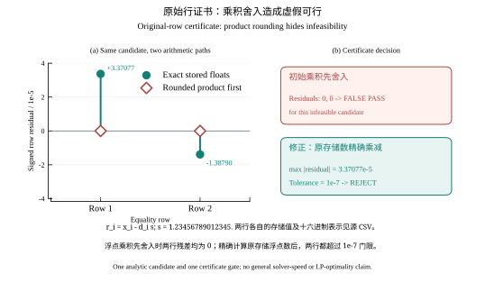
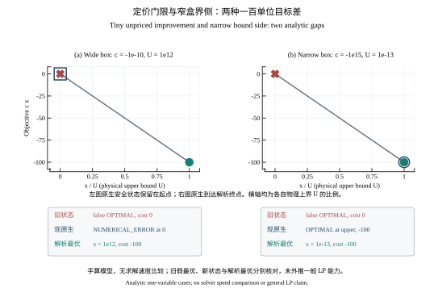

# ZYO 0.3.7 本地发布候选：原 LP 证书与数值边界

2026-10-05 · 本页随筛选源码候选编写；正式发布以冻结源码、净安装及逐文件发布回执为准。

## 前因、输入与计算

本次增量针对同一原始 LP 的三个具体误判入口：浮点乘积先舍入会抵消非零行残差；小于入基选择门的改善项会被误当作最优性证明；极窄变量盒的两侧会同时落入绝对“近界”判断。另对 CSC/CSR 同一坐标的重复系数，在进入原生齐次模型与独立证书前采用相同的 binary64 汇总语义。所有下述教学输入由解析常数构造，无第三方基准或私人论文数据。原生求解使用 ZYO 自编定价、比值和基维护；NumPy/SciPy 仅提供数组、稀疏矩阵和线性代数。

对一般线性目标和行约束，结果门重新核查原存储 binary64 数所定义的模型：

```math
\min\{c^Tx+c_0: \ell\le x\le u,\ Ax\ \mathrel{\square}\ b\},\qquad
r_j=c_j-a_j^T\lambda.
```

在**准备接受**原始可行或最优状态时，对必要的乘积分别作精确有理乘加，再按原设定容差比较原行违反、界、对偶符号、简约成本、互补与原始—对偶差。这里的精确算术是**事后证书核验**，不是以有理数运行整套单纯形。对有界的小基，另可求 $`B^Ty=c_B`$ 提议原行乘子；只有独立原模型证书完整通过，公共结果才按既定容差报告 `OPTIMAL`，同时保留底层 `raw_status=NUMERICAL_ERROR`、原因和 `fallback_used=False`。辅助基限于最多 8 行、64 列，资源门之外保留原停止状态。

独立行核验的关键实现是**先精确乘加，再比较原容差**；不把浮点乘积先舍入的结果当原式：

```python
# 证书入口中的原行计算示意；实际代码还区分 <=、>=、== 与非有限分支。
from fractions import Fraction

activity = Fraction.from_float(float(expression.constant))
for column, coefficient in expression.terms.items():
    activity += (Fraction.from_float(float(coefficient))
                 * Fraction.from_float(float(point[column])))
```

## 图 1：乘积抵消反例

令 $`s=1.23456789012345`$，两行 $`x_i-d_i s=0`$。输入 $`d_1=1151660734277`$、$`d_2=1644039625535`$，候选 $`x_1=1421803362854.3792`$、$`x_2=2029678531776.0918`$。若先在 binary64 计算 $`d_i s`$，表观残差均为 0；对这些**已经存储**的浮点数精确乘减后，残差分别为 $`+3.3707726085685508\times10^{-5}`$ 与 $`-1.3878964431723873\times10^{-5}`$，都超过本教学输入的行绝对容差 $`10^{-7}`$。原证书应拒绝该候选的可行性，不能仅凭舍入后的零报告成功。



图 1 的菱形表示“乘积先舍入”的零残差，圆点表示原存储数的精确乘减；右侧仅示意对这一候选的验收差别。源表是[固定常数与十六进制浮点表示](../figures/0.3.7/Fig01_Cancellation/source_data/analytic_rows.csv)，并附[可编辑绘图脚本](../figures/0.3.7/Fig01_Cancellation/scripts/render.py)与[QA/后端声明](../figures/0.3.7/Fig01_Cancellation/qa/figure_qa.json)。图展示数值反例，不是求解速度曲线。

绘图后同一测试文件增补了证书拒绝路径；图 1 的原 CSV、SVG 与绘图脚本字节未改。[QA](../figures/0.3.7/Fig01_Cancellation/qa/figure_qa.json)分别保留绘图时和发行时的测试源码哈希，避免把测试扩充误作图数据更新。

## 图 2：微小定价与极窄盒

两个无量纲模型均为 $`\min cx`$、$`0\le x\le U`$。宽盒取 $`(c,U)=(-10^{-10},10^{12})`$，窄盒取 $`(-10^{15},10^{-13})`$；两者手算终点目标都是 $`cU=-100`$。若从 $`x=0`$ 起步，宽盒的严格改善成本 $`10^{-10}`$ 小于当前入基选择门 $`10^{-9}`$，原生底层保守报告 `NUMERICAL_ERROR`，保留未定价原因，而非在目标 0 证明最优；窄盒精确界侧优先，正确翻界到目标 $`-100`$。把宽盒改成无上界时，微小负成本对应无界改善，进一步证明“未挑中入基列”不能等同最优。



图 2 横轴 $`u=x/U`$ 仅为展示变换，原模型仍使用各自的真实变量界；红叉为旧错误状态，蓝标记是当前底层状态，绿点是手算终点。[源 CSV](../figures/0.3.7/Fig01_UnpricedNarrow/source_data/analytic_cost_paths.csv)用十进制精确乘法生成五个位置的成本，并附[脚本](../figures/0.3.7/Fig01_UnpricedNarrow/scripts/render.py)及[QA](../figures/0.3.7/Fig01_UnpricedNarrow/qa/figure_qa.json)。两图原始版本与既有图集保持原路径和字节；本版各图有独立目录。

## 公共四行认证与重复系数

另一个手算模型为自由变量 $`p,q`$、$`v\ge0`$：

```math
\max v\quad\text{s.t.}\quad p+v\le1,\ q+v\le1,\ p-2q+v\le0,\ -2p+q+v\le0.
```

$`(p,q,v)=(1/2,1/2,1/2)`$ 可行；非负行权重 $`(1/2,0,1/6,1/3)`$ 组合后得 $`v\le1/2`$，因此该点确为全局最优。测试要求在底层微小未定价停止后，≤8 行精确基乘子建议与**原模型独立证书**同时成立，公共 `native_simplex` 才能报告按既定容差认证的目标 $`0.5`$；元数据继续显示原始数值停止原因和实际后端。该认证不把所有 `NUMERICAL_ERROR` 或其他大问题自动升级。

再以单行重复 CSC 输入验证模型一致性：$`(-2\times10^{-10}-10^{-10})x+y\le1`$、$`0\le x\le10^{12}`$，目标 $`\max -2\times10^{-10}x+y`$。$`(x,y)=(10^{12},300)`$ 原式可行、目标 100，故 $`(0,1)`$ 不可能是最优。原生齐次矩阵和证书模型现在按同一重复项合并规则解释为系数 $`-3\times10^{-10}`$，且调用方稀疏数组保持逐项不变；有限项求和溢出为非有限值时明确拒绝输入。

## 可复现入口与研究意义

安装 `.[native-sparse]` 后可运行公开手算测试，或按[原生认证 LP 教程](../native_simplex.md)自行建模：

```powershell
python -B -m unittest tests.test_lp_certificate_product_cancellation tests.test_sparse_simplex_unpriced_gap tests.test_native_lp_duplicate_entries tests.test_native_simplex_posthoc_metadata tests.test_exact_basis_dual -v
```

图件实际后端为 Python/matplotlib Agg：同日 Origin 原生试画带演示水印，故按绘图规范回退并保留可重绘源脚本。图中文字、源表、首末轴端刻度和后端证据见各自 QA。两图均为数值正确性教学，不代表全局求解速度、公开大题覆盖或商业求解器水平。

同候选源码再对公开 Netlib **开发题** `afiro`、`adlittle`、`sc50a`、`sc50b` 各运行三次并按原输入独立复核，严格原模型证书 **0/12** 通过：`afiro` 和 `sc50b` 虽有接近参考目标的候选，证书仍拒绝；`adlittle` 和 `sc50a` 保留数值停止。测试用实际原生 `native_simplex`，未回退、未调用外部求解器。这个负面结果与上述手算四行认证一同界定本版验证范围。

许可继续采用[分范围非商业测试条款](../../LICENSE-SCOPE.json)，历史 MIT 基线与第三方权利按原声明保留。本地 `import zyo` 无需远程 API 密钥；远程 API 的权限另行管理。
